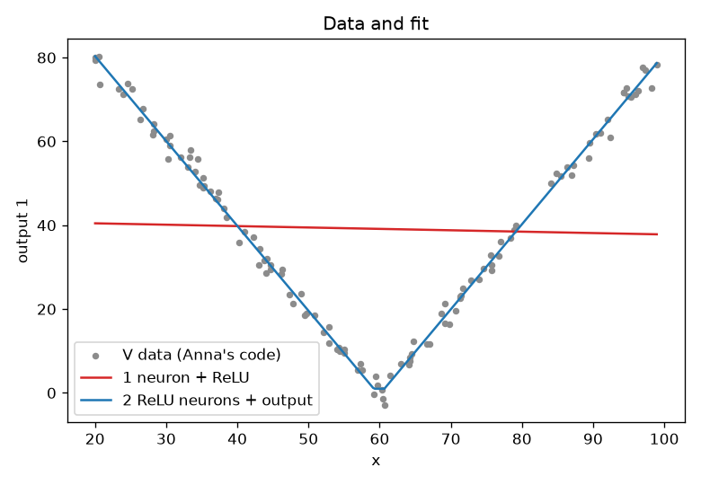
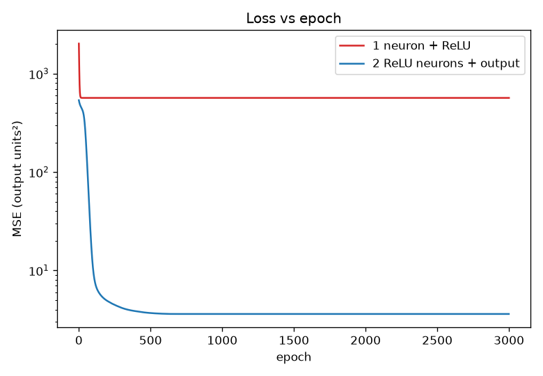

# Fitting the V in Anna's code — 11/8

Assignment: *"Show how you can fit a model to the V data in Anna's Code (what we
started in class). It should include the math behind using gradient descent to
find the weights for a single neuron and a ReLU activation layer, an Excel
spreadsheet that has 5 iterations on m & b, and a python code — with a plot of
the data and the fit and one of the loss as a function of epoch."*

| Part | Where |
|---|---|
| Fit in Anna's code | [Step 1](#1-fit-the-v-in-annas-code) below (done on the site, with screenshots) |
| The math | [Step 2](#2-the-math-gradient-descent-for-one-neuron--relu) below |
| Excel, 5 iterations on m & b | `v_fit_5_iterations.xlsx` (built by `build_workbook.py`) |
| Python + both plots | `v_fit.py` → `v_fit.png` (data + fit), `v_loss.png` (loss vs epoch) |

## The data

In Anna's site, **Fitting → Example data → V** draws 120 points with random x
in 20–100 and `y = 2·|x − 60|` plus Gaussian noise with std 2. You can see this
in [`network/training.py`](https://github.com/chrisbuerginrogers/ME193-Robotics/blob/main/Public%20stuff/AnnaCode/network/training.py)
(`EXAMPLES["v"]`). `annacode-v.tsv` is one such set, saved from the site.
Since the noise has variance 2² = 4, **no model can get the loss much below 4**.

## 1. Fit the V in Anna's code

The site's own hint for the V says: *"A V is two ramps: add a hidden layer with
at least 2 neurons and ReLU, and leave the output layer's activation as None."*

1. Open the [site](https://chrisbuerginrogers.github.io/ME193-Robotics/Public%20stuff/AnnaCode/), click **Fitting**, and pick **V** from the example dropdown in the input box.
2. Give it a hidden layer of **2 neurons with ReLU**, then the output layer (1 neuron, activation None).
3. **By hand** (this is what the Fitting tab is for): one neuron makes each arm of the V.

   | | weight | bias | makes |
   |---|---|---|---|
   | hidden neuron 1 (ReLU) | 2 | −120 | `ReLU(2x − 120)`, the right arm (0 until x = 60, then slope +2) |
   | hidden neuron 2 (ReLU) | −2 | 120 | `ReLU(120 − 2x)`, the left arm (slope −2 until x = 60, then 0) |
   | output (None) | 1, 1 | 0 | adds the two arms: `2·|x − 60|` |

4. **By gradient descent:** press **Randomize weights**, then **Train 50 epochs** a few times. If the loss stalls high, randomize and train again (see [why](#why-randomize-and-train-again)).
5. Screenshot the network and the fit plot for both.

The single neuron in steps 2–3 below is the building block: each hidden neuron
here is exactly that `ReLU(m·x + b)`, and the output adds them up.

## 2. The math: gradient descent for one neuron + ReLU

Model, with the x-scaling Anna's code also uses (`x̂ = (x − x̄)/σₓ`):

$$
\text{pre}_i = m\,\hat x_i + b, \qquad \hat y_i = \text{ReLU}(\text{pre}_i) = \max(0,\ \text{pre}_i)
$$

Loss (mean squared error over the N points):

$$
L = \frac{1}{N}\sum_i \left(y_i - \hat y_i\right)^2
$$

Chain rule. Compared with the plain line fit from the handout, the activation adds one link:

$$
\frac{\partial L}{\partial m}
= \frac{1}{N}\sum_i
\underbrace{-2\,(y_i-\hat y_i)}_{\partial L/\partial \hat y}\;
\underbrace{\text{ReLU}'(\text{pre}_i)}_{\partial \hat y/\partial\,\text{pre}}\;
\underbrace{\hat x_i}_{\partial\,\text{pre}/\partial m}
\qquad
\frac{\partial L}{\partial b}
= \frac{1}{N}\sum_i -2\,(y_i-\hat y_i)\;\text{ReLU}'(\text{pre}_i)\cdot 1
$$

$$
\text{ReLU}'(\text{pre}) = \begin{cases} 1 & \text{pre} > 0 \ \ (\text{neuron on}) \\ 0 & \text{pre} \le 0 \ \ (\text{neuron off}) \end{cases}
$$

Update with learning rate α, and repeat:

$$
m \leftarrow m - \alpha\,\frac{\partial L}{\partial m}, \qquad b \leftarrow b - \alpha\,\frac{\partial L}{\partial b}
$$

What this means:

- **With no activation**, ReLU′ would be 1 everywhere, and this reduces to the handout's line fit.
- **With ReLU**, a point where the neuron is off contributes nothing to the gradient. The neuron only learns from points where it's on. That's also why m = b = 0 is a bad start: every point has pre = 0, every ReLU′ is 0, and nothing ever moves.
- **Why x̂:** x runs from 20 to 100, so changing m by a little changes the prediction a lot. With raw x the learning rate has to be tiny. Scaling x makes one learning rate work for both m and b. To go back to raw x: `m_raw = m/σₓ`, `b_raw = b − m·x̄/σₓ`.
- The factor 2 comes from differentiating the square. It's the same convention as PyTorch's `MSELoss` and Anna's code (`2·err·f′(pre)`).

**Two neurons (the network in step 1).** The output is
`ŷ = v₁·ReLU(w₁x̂ + c₁) + v₂·ReLU(w₂x̂ + c₂) + d`, and each hidden neuron gets
the same rule as above, with the output weight inserted into the chain:

$$
\frac{\partial L}{\partial w_j} = \frac{1}{N}\sum_i -2\,(y_i-\hat y_i)\; v_j\; \text{ReLU}'(w_j\hat x_i + c_j)\; \hat x_i
$$

That's backpropagation: the error is sent back through `v_j`, then through
ReLU′. The output weights get `∂L/∂v_j = (1/N)Σ −2(y−ŷ)·ReLU(w_j x̂ + c_j)`.

## 3. Excel: 5 iterations on m & b

`v_fit_5_iterations.xlsx`, starting from m = b = 1 with α = 0.1:

- **Iteration 1–5** tabs: one row per data point, with x̂, z, ReLU(z), ReLU′(z), the error and the two chain-rule terms. Their averages at the top are that iteration's gradients and loss.
- **Summary** tab: the inputs (yellow, change them and everything recalculates), one row per iteration (m, b, ∂L/∂m, ∂L/∂b, loss, points with ReLU off), the m and b after 5 updates, a loss chart, and a data + fit chart.

| iteration | m | b | ∂L/∂m | ∂L/∂b | loss | points off |
|---|---|---|---|---|---|---|
| 1 | 1.000 | 1.000 | −32.099 | −49.695 | 2020.1 | 25 |
| 2 | 4.210 | 5.969 | −5.997 | −56.320 | 1689.1 | 8 |
| 3 | 4.810 | 11.602 | 11.129 | −55.193 | 1359.3 | 0 |
| 4 | 3.697 | 17.121 | 8.903 | −44.154 | 1074.0 | 0 |
| 5 | 2.806 | 21.536 | 7.122 | −35.323 | 891.4 | 0 |
| after 5 | 2.094 | 25.069 | | | 774.6 | 0 |

The workbook's formulas were evaluated with the Python `formulas` package and
match `v_fit.py` to every printed digit.

## 4. Python

`v_fit.py` uses numpy with the gradients written out exactly as in step 2:

- **Part 1:** one neuron + ReLU. It uses the same start and learning rate as the spreadsheet, so its epochs 0–4 are the table's iterations 1–5, and epoch 5 is "after 5".
- **Part 2:** the 2-ReLU-neuron network from step 1, trained like Anna's code (x and y standardized, the same random-weight scheme). It retries from new random weights until a run reaches the V.

```bash
../venv/bin/python v_fit.py
```




`one_neuron.py` is an optional PyTorch version of part 1 (`nn.Linear(1,1)` →
`nn.ReLU()`). Autograd computes the same gradients, which double-checks the
hand-derived ones. Run it with `../CustomRobotCentering/.venv/bin/python`,
which has torch.

## Results, and what they show

**One neuron + ReLU can't make a V.** `ReLU(m·x + b)` is a single ramp: flat on
one side, sloped on the other. From every start tried, gradient descent ends
at `y = ReLU(−0.033x + 41.1)` with loss 567.

The data is all positive, so b keeps rising until the neuron is on for all 120
points. The ReLU then never bends, and the result is just the best straight
line through the V. The spreadsheet's 5 iterations show it heading there: b
climbs from 1 to 25 while the loss falls from 2020 to 775.

**Two ReLU neurons fit the V.** Gradient descent found ramps of slope −2.03 and
+2.03 that turn on at x ≈ 59 and 61, with loss **3.6**. That's at the noise
floor of about 4, the same answer as the hand-set weights in step 1.

### Why "randomize and train again"?

Randomizing gives every hidden neuron a zero bias, so each one starts with its
corner in the middle of the data (on for about half the points). Runs get stuck
during training, in one of two ways:

- **A neuron dies.** A step pushes its corner past the edge of the data, so it's off for every point. From then on it gets no gradient and never recovers.
- **Both neurons keep corners, but in the wrong places**, for example both bending on the same arm. That's a shallow dip in the loss landscape.

For 2 neurons over 60 random starts, with Anna's settings (lr 0.05, averaged
gradients capped at ±5), 34 reached the V. Of the 26 that got stuck, 14 had a
dead neuron and the other 12 mostly had misplaced corners. With `v_fit.py`'s settings (lr 0.1,
no cap), 14 of 60 reached the V. That's why `v_fit.py` retries, and why the
site's hint says to randomize and train again.

With `v_fit.py`'s settings, over 30 random starts each:

| hidden ReLU neurons | starts that reach the V |
|---|---|
| 2 | 6 / 30 |
| 3 | 15 / 30 |
| 4 | 25 / 30 |
| 6 | 28 / 30 |

Spare neurons make it much more likely that, after randomizing, one neuron
already faces each arm.
